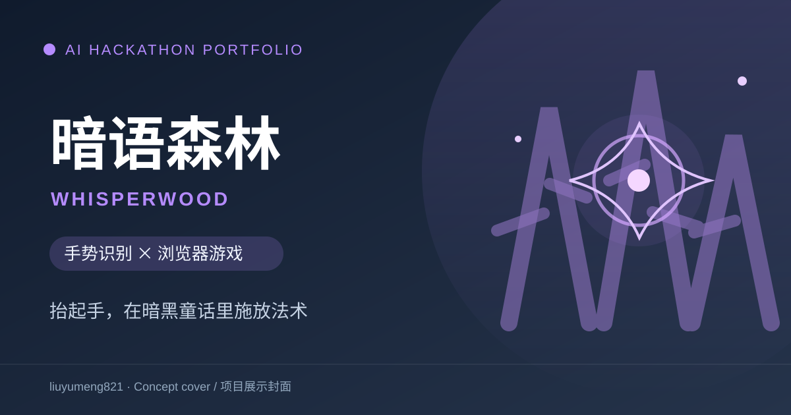

# 暗语森林 · WhisperWood



**产品定位：** 面向喜欢互动叙事的玩家，在浏览器里用摄像头识别手势和轨迹，完成暗黑童话风格的施法对战。

[游戏视觉素材](demon-eye.png) · [本地试玩](#快速开始) · [路演材料](docs/roadshow.pptx) · [代码与文档](#材料与验证)

> 封面为概念展示图，不是实际游戏截图。目前没有公开在线试玩或演示视频；本地试玩需要摄像头与模型下载。

> 在浏览器中用手势施法，让摄像头输入成为暗黑童话对战的交互方式。

开发者：[liuyumeng821](https://github.com/liuyumeng821) · 联系：yumengliu398@gmail.com  

## 项目价值

在浏览器中用手势施法，让摄像头输入成为暗黑童话对战的交互方式。

## 技术与工程亮点

**技术栈：** JavaScript · MediaPipe Tasks Vision · Canvas · Web Audio

静态姿态与动态轨迹融合；EMA 平滑、方向投票与组合动作；手势与关卡机制结合；浏览器低门槛体验。

## 快速开始

```bash
python -m http.server 8000
```
在 Chrome/Edge 打开 `http://localhost:8000`，允许摄像头。需联网下载 MediaPipe WASM 与模型；远程部署需 HTTPS。尽量保持手部光线充足、轮廓完整。

## 材料与验证

- **代码入口：** [页面](index.html) · [手势识别](gesture.js) · [关卡规则](ruleEngine.js) · [主交互](app.js) · [音效](sfx.js)。
- **产品材料：** [项目介绍](docs/product-intro.docx) · [路演 PPT](docs/roadshow.pptx) · [演示脚本](docs/demo-script.original.md)。
- [项目展示卡](docs/SHOWCASE.md)
- [验证记录](docs/VALIDATION.md)
- [作品集总览](https://github.com/liuyumeng821/ai-hackathon-portfolio)
